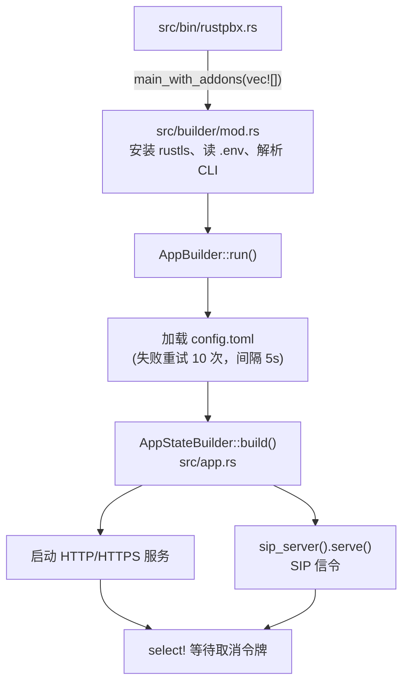

# 系统架构

本页回答一个问题：**RustPBX 进程启动后，各个部分是怎么拼起来的。** 读完你应该能在代码里找到任何一条请求 / 呼叫的路径。

## 从 main 到监听端口



- 社区版二进制入口只有一行：`src/bin/rustpbx.rs` 调用 `rustpbx::builder::main_with_addons(vec![])` —— "核心 + 空插件列表"。商业版本在自己的二进制里传入各自的插件集。
- CLI 参数（clap derive，`src/builder/cli.rs`）：

  | 参数 | 作用 |
  |---|---|
  | `--conf <TOML>` | 指定配置文件 |
  | `--super-username / --super-password / --super-email` | 一次性创建 / 更新控制台超级管理员 |
  | `--tokio-console <addr>` | 启用 tokio-console 诊断 |
  | `--skip-migrate` | 跳过数据库迁移 |
  | 子命令 `check-config` | 校验配置后退出 |
  | 子命令 `dump` | 导出数据库 DDL 后退出 |

- 配置加载是纯 `toml::from_str`（`src/config.rs` 的 `Config::load()`），环境变量只影响少数开关。加载失败最多重试 10 次、间隔 5 秒。

## 三个 tokio runtime

RustPBX 把三类负载隔离到独立 runtime，互不拖累：

| Runtime | 职责 | 线程数配置 |
|---|---|---|
| `sip-worker` | SIP 信令处理（8MB 栈） | `[proxy].sip_worker_threads` |
| `media-worker` | RTP 转发（媒体面） | `[proxy].media_worker_threads` |
| `rwi-webhook` | Webhook 出站 HTTP | `[proxy].rwi_webhook_worker_threads` |

::: tip 为什么这样分
媒体面（RTP 转发）对延迟最敏感，信令面可能被 Webhook 等待阻塞。分 runtime 保证一个 Webhook 上游卡死不会拖慢通话媒体。
:::

## AppState：所有服务的组装点

`src/app.rs` 的 `AppStateBuilder::build()` 是核心组装函数，按顺序创建：

1. HTTP client、`Storage`、数据库连接（可跳过迁移）
2. **插件注册表**（addon registry）+ 插件自己的数据库迁移
3. **SipFlow 后端**（信令 / 媒体抓取）
4. **CallRecordManager** 及其 hooks（SipFlow 上传、录音上传、通话计数）
5. **ConsoleState**（Web 控制台状态）
6. **SipServerBuilder** —— 注册 5 个 SIP 模块：`acl` / `auth` / `presence` / `registrar` / `call`
7. 后台任务：录音上传、CDR 消费、RWI Webhook 处理、stats log、Prometheus 采样器、CDR 日聚合、运行时快照、集群 AMI 同步、许可证校验、控制台更新检查

最后 `app::run()` 绑定 `http_addr` 的 TCP listener，按需挂载：

- SIP-over-WebSocket 升级路由（配置了 `[proxy].ws_handler` 时）
- HTTPS（手动指定证书，或自动扫描 `config/certs/*.crt`）
- AMI 路由（默认 `/ami/v1`）、RWI WebSocket 路由（默认 `/rwi/v1`）、控制台路由与 REST API（默认 `/api`）、静态文件

HTTP 服务、HTTPS 服务、SIP serve 三者在一个 `select!` 里并行，直到收到取消令牌。

## SIP 模块系统

SIP 代理是**模块化管线**。每个模块实现 `ProxyModule` trait（`src/proxy/mod.rs`）：

```rust
pub trait ProxyModule {
    fn name(&self) -> &str;
    fn allow_methods(&self) -> &[Method];          // 声明关心哪些 SIP 方法
    async fn on_transaction_begin(&self, ...) -> ProxyAction;  // Continue 或 Abort
    async fn on_transaction_end(&self, ...);
    // on_start / on_stop 生命周期
}
```

每条 SIP 事务依次流经已注册的模块，任一模块返回 `Abort` 即终止后续处理。内置模块：

| 模块 | 职责 |
|---|---|
| `acl` | IP / User-Agent 过滤、垃圾呼叫（spam）标记 |
| `auth` | Digest 鉴权质询；通过 `AuthBackend` trait 对接各用户后端 |
| `presence` | 在线状态（presence） |
| `registrar` | 注册 / 注销，写入位置库（Locator） |
| `call` | 呼叫处理核心，触发路由决策（HTTP Router 或静态拨号计划） |

模块组合由 `[proxy].modules` 控制。

## 用户后端与位置库

鉴权（"这个分机存不存在、密码对不对"）与定位（"这个分机现在注册在哪"）是两套独立的可插拔抽象：

**用户后端**（`UserBackend` trait）：

| 类型 | 说明 |
|---|---|
| `memory` | 内存，配置文件里直接写用户 |
| `extension` | 内置分机库（数据库表） |
| `database` | 自定义表 / 列映射 |
| `http` | 调你的 HTTP 接口鉴权（支持 token 缓存、超时重试） |
| `plain` | 纯文本文件 |

**位置库**（`Locator` trait）：`memory` / `http` / `database` 三种实现，决定注册信息存哪、集群内怎么共享。

## Workspace 结构

`crates/` 下是可独立复用的子 crate，主 crate 通过 `pub use` 直接暴露为 `media` / `models` / `sipflow` / `storage` / `http_util`：

| Crate | 用途 |
|---|---|
| `rustpbx-models` | SeaORM 实体与迁移（用户、CDR、RBAC、安全封禁等） |
| `rustpbx-storage` | 统一对象存储抽象：S3 / Azure / GCS / 本地文件 + 预签名 URL |
| `rustpbx-sipflow` | SIP/RTP 抓取落盘：包协议、SDP 解析、RTP 统计、WAV 导出 |
| `rustpbx-media` | 协议无关媒体引擎：桥接、放音、录音、DTMF、MCU 混音、转码 |
| `rustpbx-http-util` | 共享 HTTP 工具：keepalive client、声明式 multipart 上传器 |
| `rustpbx-record-common` | 录音公共原语：DTMF 合成、WAV 头、混音 / 静音 / 交织、解码重采样 |

## 源码目录导览

| 目录 | 内容 |
|---|---|
| `src/bin/` | 两个二进制：`rustpbx`（主程序）、`sipflow`（独立抓包工具） |
| `src/builder/` | 启动编排：CLI、日志、优雅停机、配置热重载 |
| `src/proxy/` | SIP 代理：模块系统、传输层（UDP/TCP/TLS/WS）、路由、中继健康检查 |
| `src/call/` | 呼叫模型：Leg/Session、命令状态机、队列 / 会议 / IVR 应用 |
| `src/proxy/proxy_call/sip_session/` | `SipSession` —— B2BUA 会话执行体（本项目最大的文件） |
| `src/rwi/` | RWI WebSocket：命令分发、事件定义、Webhook 推送 |
| `src/api/` + `src/console/` | REST API 与 Web 控制台 |
| `src/handler/` | AMI 运维路由与中间件 |
| `src/outbound/` | 预测式外呼 SSE API |
| `src/addons/` | 插件：ACME、归档、转写、可观测性、队列管理 |
| `src/callrecord/` | CDR 与录音产物的落库 / 上传管道 |
| `src/tts/` | IVR 动态语音合成（http / cli 两种驱动） |
| `src/security/` | 登录失败封禁（BanStore）与告警 |

## 优雅停机与配置热重载

- **优雅停机**：收到信号后，新呼叫 / 新注册回 `503`，等待活动呼叫归零（超时由 `[graceful_shutdown].drain_timeout_secs` 控制，默认 300 秒）再真正退出。
- **配置热重载**：本质是**重建整个 AppState**（会等待 SIP 端口释放后重新绑定）。控制台里改配置走 `PATCH /api/settings/config/*`，集群场景还有 SSE 进度流。

下一步：了解一次呼叫如何流经这些组件 → [呼叫模型与路由](/guide/call-model)。
